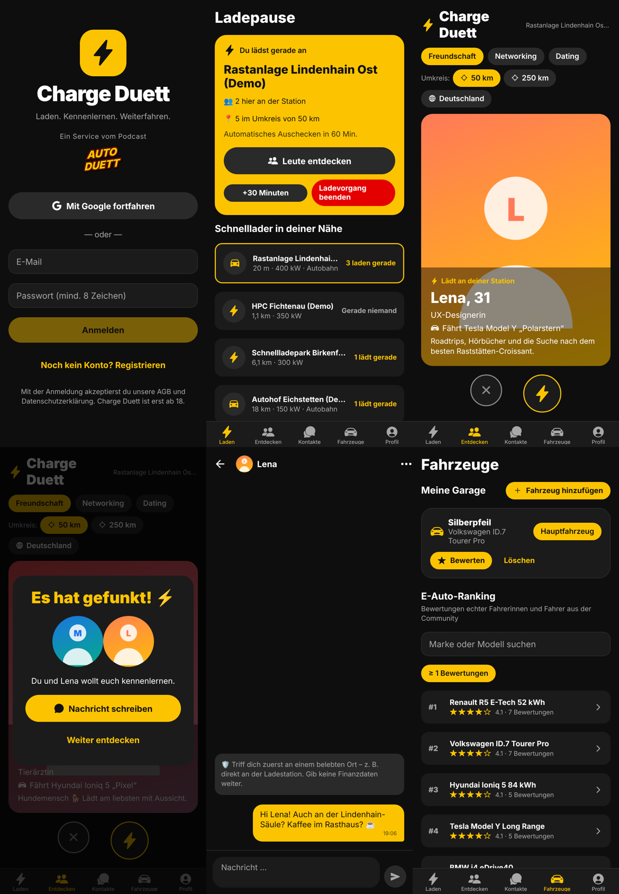

# Charge Duett – MVP

Ein Name für alle Märkte (Deutsch und Englisch); zentral in `src/lib/i18n.ts` → `brand.appName`.

Native App (iOS & Android, zusätzlich Web) für Menschen, die gerade ihr E-Auto laden:
Check-in an der Ladesäule → sehen, wer im Umkreis ebenfalls lädt → swipen → bei gegenseitigem
Interesse chatten. Dazu eine Fahrzeug-Garage und ein Community-Ranking aller E-Autos.

Betreiber: Strauss Media GmbH · Ein Service vom Podcast **Auto Duett** · Stack: **Expo (React Native, SDK 58) + Supabase (Postgres/PostGIS)**



Design: Farbwelt des Podcasts Auto Duett (Gelb `#FCC400`, Rot `#FF1A1A`, Schwarz), durchgehend dunkles Theme – zentral in `src/lib/theme.ts`. Der Hinweis „Ein Service vom Podcast“ mit Auto-Duett-Schriftzug steht auf Login, Laden-Tab, Profil und Impressum (`src/components/PodcastBadge.tsx`). Die Grafik `assets/brand/auto-duett.png` ist ein **Nachbau** des Logos – für exakte Typografie einfach durch das Original (transparentes PNG) ersetzen, keine Code-Änderung nötig.

Alle Screenshots stammen aus einem automatisierten Klick-Durchlauf gegen die echte Datenbanklogik
(siehe „Tests“): [`docs/screenshots/`](docs/screenshots/).

---

## 1. Was das MVP kann

| Bereich | Umsetzung |
|---|---|
| **Modi** | Freundschaft, Networking, Dating – frei kombinierbar; Dating mit Geschlechts- und Altersfiltern in beide Richtungen |
| **Anmeldung** | E-Mail/Passwort, Google, Sign in with Apple (iOS) |
| **Onboarding** | Name, Geburtsdatum (18+, serverseitig erzwungen, danach gesperrt), Geschlecht, Modi, bis 6 Fotos, Bio, Beruf, Einwilligungen |
| **Laden / Check-in** | Manueller Check-in per GPS: nächster Schnelllader ≥ 50 kW im Umkreis von 250 m. Auto-Checkout nach 60 Min. (verlängerbar bis 3 h) oder wenn man sich > 500 m entfernt |
| **Stationsliste** | Schnelllader im Umkreis 25 km mit **Anzahl** ladender Nutzer – nie Identitäten |
| **Entdecken** | Swipe-Stapel: Personen, die gerade laden – Umkreis wählbar: 50 km (Standard), 250 km oder bundesweit. Gleiche Station zuerst; andere Stationen nur als Entfernungsstufe (< 10/25/50/100/250 km bzw. „woanders in Deutschland“), nie mit Ort |
| **Match & Chat** | Match nur bei gegenseitigem Like; Echtzeit-Chat (Supabase Realtime), Gelesen-Status; Match bleibt nach dem Laden bestehen |
| **Sicherheit** | Melden (7 Gründe) → automatisch blockieren; Blockieren; Kontakt lösen; Sicherheitshinweis im Chat |
| **Moderation** | Meldungen landen in `reports`; Admins sperren über `admin_resolve_report()` |
| **Fahrzeuge** | Garage mit mehreren Autos (Spitzname, Beschreibung, Baujahr, Hauptfahrzeug) aus fester Modellliste (~145 Modelle) |
| **Bewertungen** | 7 Kriterien à 1–5 Sterne + Freitext; nur für Modelle in der eigenen Garage; öffentliches Ranking + Erfahrungsberichte (nur Initiale) |
| **Werbung** | AdMob: Werbekarte nach jeweils 10 Profilen im Swipe-Stapel, Banner im Ranking, nicht im Chat. Google-Consent-Dialog (DSGVO/TCF) vor dem ersten Laden |
| **DSGVO** | Einwilligungsprotokoll (versioniert, widerrufbar), Datenexport (Art. 15/20), Konto-Löschung in der App (Art. 17, auch App-Store-Pflicht) |
| **Datenprodukte** | Schema `analytics`: nur aggregiert, nur mit Einwilligung, k ≥ 5 – siehe Abschnitt 6 |
| **Push** | Neues Match, neue Nachricht (Sperrbildschirm standardmäßig ohne Inhalt), optional „Jemand Neues lädt an deiner Station“ (max. 1× pro Ladevorgang), lokale Erinnerung 5 Min. vor Auto-Checkout mit Knopf „+30 Minuten“. Erlaubnis wird erst beim ersten Match abgefragt; jede Art einzeln abschaltbar; keine Marketing-Pushes |
| **Sprachen** | Deutsch & Englisch (automatisch nach Gerätesprache, im Profil umschaltbar) |

### Bewusst NICHT im MVP
- Admin-Oberfläche (Moderation läuft im Supabase-Dashboard, siehe 4.6)
- Automatische Bildprüfung (Nacktheit/Gewalt) – derzeit nur über Meldungen
- Standort im Hintergrund (absichtlich: Akku, Datenschutz, App-Review)
- Premium-Funktionen (Super-Like, Boost, „Wer hat mich geliked“)

---

## 1b. Klickbare Demo

`dist-artifact/chargeduett-demo.html` ist die komplette App als eine einzige HTML-Datei im **Demo-Modus**:
- fiktive Personen und Ladesäulen in ganz Deutschland
- Standort simuliert (Rastanlage Lindenhain)
- automatische Chat-Antworten
- kein Server nötig, Daten bleiben im Browser

Neu bauen:

```bash
EXPO_PUBLIC_DEMO=1 npx expo export --platform web --output-dir /tmp/demoweb
```

Danach mit dem Pack-Skript zu einer Datei zusammenfassen (Skript in `tools/pack-demo.py`):

```bash
python3 tools/pack-demo.py /tmp/demoweb dist-artifact/chargeduett-demo.html
```

Der Demo-Modus ersetzt nur die Backend-Schicht (`src/lib/demo/`). Alle Bildschirme sind dieselben wie in der echten App.

## 2. Projektstruktur

```
chargeduett/
├─ src/app/                 Bildschirme (Expo Router, jede Datei = Route)
│  ├─ (auth)/sign-in.tsx    Login/Registrierung
│  ├─ onboarding.tsx        4-Schritte-Onboarding
│  ├─ (tabs)/index.tsx      Laden: Check-in + Stationen
│  ├─ (tabs)/discover.tsx   Swipen
│  ├─ (tabs)/matches.tsx    Kontakte
│  ├─ (tabs)/vehicles.tsx   Garage + Ranking
│  ├─ (tabs)/profile.tsx    Profil
│  ├─ chat/[matchId].tsx    Chat, Melden, Blockieren
│  ├─ vehicle/…             Fahrzeug anlegen, Modell-Detail & Bewertung
│  └─ settings/…            Profil bearbeiten, Datenschutz & Konto
├─ src/components/          UI-Bausteine, Swipe-Stapel, Profilkarte, Formulare
├─ src/lib/                 Supabase-Client, API-Wrapper, Auth, Lade-Session, Werbung, i18n
├─ supabase/migrations/     Datenbankschema, RLS, Geschäftslogik (RPCs), Analytics, Storage
├─ supabase/seed/           Fahrzeug-Stammdaten
├─ supabase/tests/          SQL-End-to-End-Test
├─ scripts/import-stations.mjs   Import BNetzA-Ladesäulenregister + Open Charge Map
└─ tools/demo-backend/      Supabase-Attrappe für lokale UI-Tests (nicht für Produktion)
```

**Architekturprinzip:** Alles, was andere Nutzer betrifft (Kandidaten, Matches, Partnerprofile,
Zähler), läuft über `SECURITY DEFINER`-Funktionen in Postgres. Clients können fremde Profile,
Geburtsdaten, Ladevorgänge oder Swipes **nicht** direkt lesen – Row Level Security ist überall aktiv.
GPS-Koordinaten der Nutzer werden **nicht gespeichert**, nur die Station.

---

## 3. Schnellstart (Entwicklung)

Voraussetzungen: Node 20+, ein Supabase-Projekt (Region **EU/Frankfurt**), für iOS-Builds ein Mac
mit Xcode **oder** ein Expo-Konto für Cloud-Builds (EAS).

```bash
npm install
```

```bash
cp .env.example .env   # Supabase-URL und Anon-Key eintragen
```

Die App nutzt native Module (AdMob, Apple-Login), läuft also **nicht vollständig in Expo Go**.
Ein Development-Build ist nötig:

```bash
npx expo run:android
```

```bash
npx expo run:ios
```

Ohne Mac/Android Studio über die Expo-Cloud:

```bash
npx eas-cli@latest build --profile development --platform all
```

Schnell im Browser ansehen (Werbung erscheint dort als Platzhalter):

```bash
npx expo start --web
```

---

## 4. Supabase einrichten

### 4.1 Datenbank
Mit der Supabase-CLI (empfohlen):

```bash
npx supabase link --project-ref DEIN_PROJEKT
```

```bash
npx supabase db push
```

Danach die Fahrzeugliste laden (SQL-Editor oder `psql`): Inhalt von `supabase/seed/vehicle_models.sql` ausführen.

Alternativ alle Dateien aus `supabase/migrations/` der Reihe nach im SQL-Editor ausführen.

### 4.2 Erweiterungen
Dashboard → Database → Extensions: **postgis** und **pg_cron** aktivieren (pg_cron schließt abgelaufene
Ladevorgänge jede Minute; ist es beim Migrieren schon aktiv, wird der Job automatisch angelegt).

### 4.3 Anmeldung
- Authentication → Providers: **Email** (Bestätigung an), **Google**, **Apple**
- Authentication → URL Configuration → Redirect URLs: `chargeduett://**`
- Apple verlangt „Sign in with Apple“, sobald Google-Login angeboten wird – ist eingebaut.

### 4.4 Ladestationen importieren
1. CSV „Ladesäulenregister“ von der Bundesnetzagentur herunterladen.
2. Optional kostenlosen API-Key bei Open Charge Map holen.
3. Import ausführen (der **Service-Role-Key** gehört nie in die App):

```bash
SUPABASE_URL=https://DEIN-PROJEKT.supabase.co SUPABASE_SERVICE_ROLE_KEY=... node scripts/import-stations.mjs --bnetza ./Ladesaeulenregister.csv --ocm-key DEIN_OCM_KEY
```

Probelauf ohne Schreiben: `--dry-run` anhängen. Monatlich wiederholen (Upsert, keine Dubletten).
Der Parser ist an einem nachgebauten Beispiel getestet, **nicht** an der echten aktuellen BNetzA-Datei
(kein Zugriff aus der Build-Umgebung) – beim ersten Import bitte die Ausgabe prüfen.

### 4.5 Werbung
AdMob-Konto anlegen, App + zwei Anzeigenblöcke (adaptives Banner, 300×250) erstellen,
IDs in `.env` und die **App-IDs** in `app.json` → `react-native-google-mobile-ads` eintragen
(dort stehen derzeit Googles Test-IDs). Im Debug-Modus werden immer Test-Anzeigen geladen.
In AdMob unter „Datenschutz & Mitteilungen“ eine **DSGVO-Mitteilung** veröffentlichen – sonst zeigt
der Consent-Dialog nichts an.

### 4.6 Push-Benachrichtigungen
1. Expo-Projekt verknüpfen (legt die `projectId` in `app.json` an):

```bash
npx eas-cli@latest init
```

2. Zugangsdaten für Apple (APNs-Key) und Google (FCM) einmalig bei Expo hinterlegen:

```bash
npx eas-cli@latest credentials
```

3. In Supabase die Erweiterung **pg_net** aktivieren. Die Trigger aus `…_push.sql` senden dann direkt an den
   Expo-Push-Dienst. Ohne pg_net werden Pushes nur in `push_outbox` protokolliert (praktisch zum Testen).
4. Testen geht nur auf echten Geräten mit Development-Build, nicht im Simulator und nicht in der Web-Demo.

### 4.7 Moderation
Sich selbst zum Admin machen (SQL-Editor):

```sql
insert into public.admins (user_id) select id from auth.users where email = 'moderation@deine-domain.de';
```

Offene Meldungen ansehen und bearbeiten (SQL-Editor, dort läuft man als Superuser):

```sql
select r.id, r.created_at, r.reason, r.details, p.display_name, p.photos
from public.reports r join public.profiles p on p.id = r.reported_id
where r.status = 'open' order by r.created_at;
```

```sql
update public.reports set status = 'actioned', reviewed_at = now() where id = 123;
update public.profiles set is_banned = true where id = 'USER-UUID';
```

Für eine spätere Admin-App existieren bereits `admin_open_reports()` und `admin_resolve_report()`.

---

## 5. Tests

**Datenbank (End-to-End-Szenario, 25+ Prüfungen):** Check-in, 18+-Sperre, Einwilligungspflicht,
Sichtbarkeit (niemand sieht fremde Sessions/Profile/Chats), Swipe → Match, Chat, Wegfahren →
Auto-Checkout, Melden → Block, Admin-Rechte, Export, Konto-Löschung mit Kaskade.
Läuft gegen reines Postgres 16 + PostGIS:

```bash
psql -d testdb -f supabase/tests/00_supabase_stub.sql
```

```bash
for f in supabase/migrations/*.sql supabase/seed/vehicle_models.sql supabase/tests/01_scenario.sql; do psql -d testdb -v ON_ERROR_STOP=1 -f "$f"; done
```

**App:** `npm run typecheck` ist sauber; Metro-Bundles für iOS, Android und Web bauen fehlerfrei.
Der Klick-Durchlauf in `tools/demo-backend/` (Playwright gegen die Web-Version + echte Postgres-Logik)
deckt Login, Onboarding, Check-in, Swipen, Match, Chat, Kontakte, Ranking, Bewertung und Datenschutz ab.
**Nicht getestet:** auf echten iPhones/Android-Geräten, Apple-/Google-Login, echte AdMob-Anzeigen,
Supabase-Realtime (die Attrappe hat keinen Websocket).

---

## 6. Recht & Datenschutz – bitte vor dem Launch klären

1. **Daten verkaufen.** Personenbezogene Daten (Profil, Ladeverlauf, Chats, Standort) dürfen nicht
   ohne ausdrückliche, freiwillige, jederzeit widerrufbare Einwilligung an Dritte gehen, und die App
   darf davon nicht abhängen (Kopplungsverbot). Das MVP setzt deshalb um:
   - eigene Einwilligung `data_sharing`, standardmäßig **aus**
   - nur **aggregierte** Auswertungen im Schema `analytics`
   - nur Gruppen mit mindestens 5 Personen
   - Zugriff nur mit dem Service-Role-Key

   Wer Rohdaten einzelner Personen verkaufen will, braucht einen Anwalt, nicht mehr Code.
   Realistisch werden das ohnehin nur wenige Prozent der Nutzer erlauben.
2. **Datenschutz-Folgenabschätzung (Art. 35 DSGVO)**: Bei Standort + Dating (Rückschlüsse auf sexuelle
   Orientierung, Art. 9) sehr wahrscheinlich Pflicht. Ebenso Verzeichnis der Verarbeitungstätigkeiten,
   AV-Verträge mit Supabase und Google.
3. **Datenschutzerklärung, AGB, Community-Regeln, Impressum** – in der App wird darauf verwiesen,
   die Texte fehlen noch.
4. **Datenquellen:** BNetzA-Daten sind CC BY 4.0 (Quellenangabe ist eingebaut). Open-Charge-Map-Daten
   haben je nach Quelle unterschiedliche Lizenzen – vor kommerzieller Nutzung prüfen.
5. **App Stores:**
   - Melden, Blockieren und Konto-Löschung sind eingebaut (Apple-Richtlinien 1.2 und 5.1.1(v)).
   - Für Apple ein Demo-Konto für das Review bereitstellen.
   - Altersfreigabe 17+ bzw. 18 angeben.
   - Bei Google Play das Formular „Datensicherheit“ ausfüllen.
6. **Name „Charge Duett“:** Vor dem Launch Markenrecherche (DPMA/EUIPO, Klassen 9/38/42/45),
   Domains und Verfügbarkeit der Namen in App Store / Play Store prüfen. Der Store-Name wird pro Sprache
   in App Store Connect bzw. der Play Console gepflegt, nicht im Code.

---

## 7. Konfiguration

Alle Schwellwerte zentral in `public.cfg()` (Migration `…_functions.sql`):

| Schlüssel | Wert | Bedeutung |
|---|---|---|
| `checkin_radius_m` | 250 | max. Abstand Handy ↔ Station |
| `moved_away_m` | 500 | ab hier Auto-Checkout |
| `min_station_kw` | 50 | nur Schnelllader |
| `discovery_radius_m` | 50 000 | Umkreis fürs Entdecken |
| `session_minutes` / `extend_minutes` / `max_session_minutes` | 60 / 30 / 180 | Dauer eines Check-ins |

Werbekarten-Abstand: `AD_EVERY` in `src/app/(tabs)/discover.tsx`.

---

## 8. Bekannte Grenzen / nächste Schritte

1. Push: Zustellquittungen des Expo-Dienstes auswerten und ungültige Tokens sofort löschen (derzeit nach 90 Tagen ohne Erneuerung).
2. **Kaltstart-Problem:** Matches gibt es nur, wenn zwei Nutzer zur selben Zeit im Umkreis von 50 km
   laden. Vor dem Launch sollten an wenigen Ladeparks konzentriert Nutzer gewonnen werden.
   Dafür bieten sich Kooperationen mit Ladeparkbetreibern an, statt einer bundesweiten Streuung.
3. Fotos liegen in einem öffentlichen Bucket mit nicht erratbaren Pfaden. Besser wären signierte URLs
   und eine automatische Bildprüfung.
4. Rate-Limits für Swipes/Nachrichten (Spam-Schutz) fehlen.
5. Fotos gesperrter oder gelöschter Konten werden nur clientseitig entfernt. Eine Edge Function
   zum Aufräumen fehlt noch.
6. Fahrzeug-Stammdaten sind Richtwerte und müssen vor dem Launch redaktionell geprüft werden.
7. Realtime-Chat nur im Vordergrund, kein Offline-Puffer.
